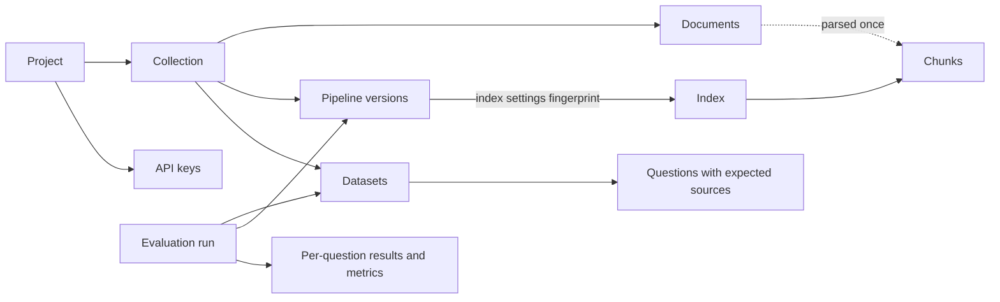
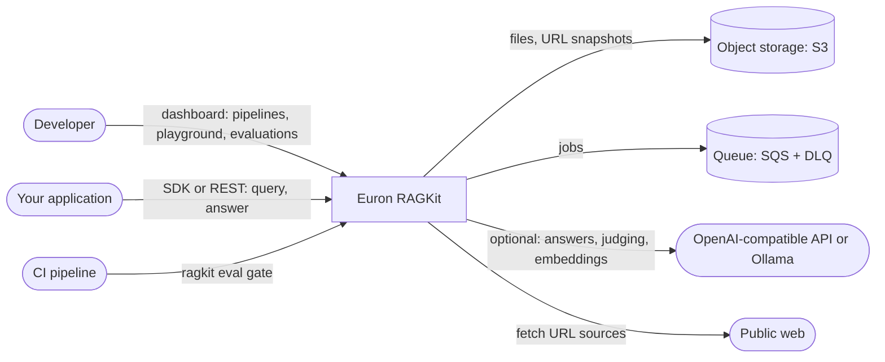
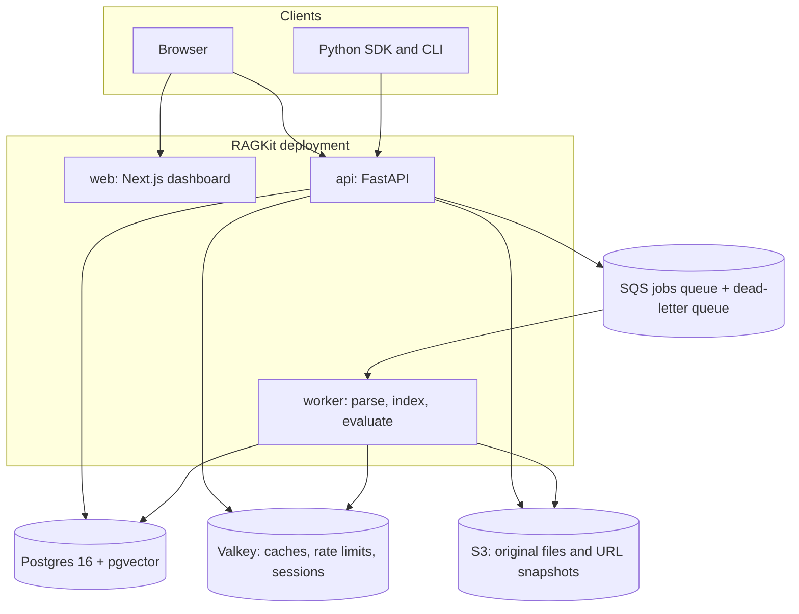
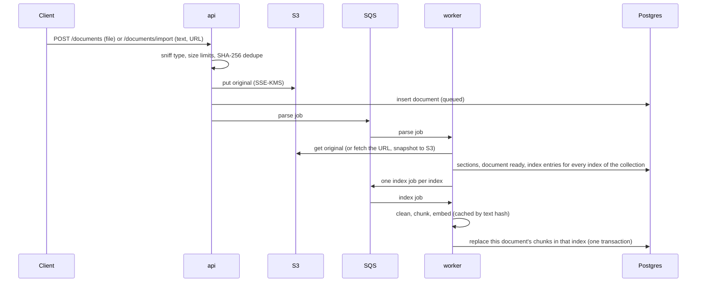
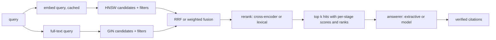
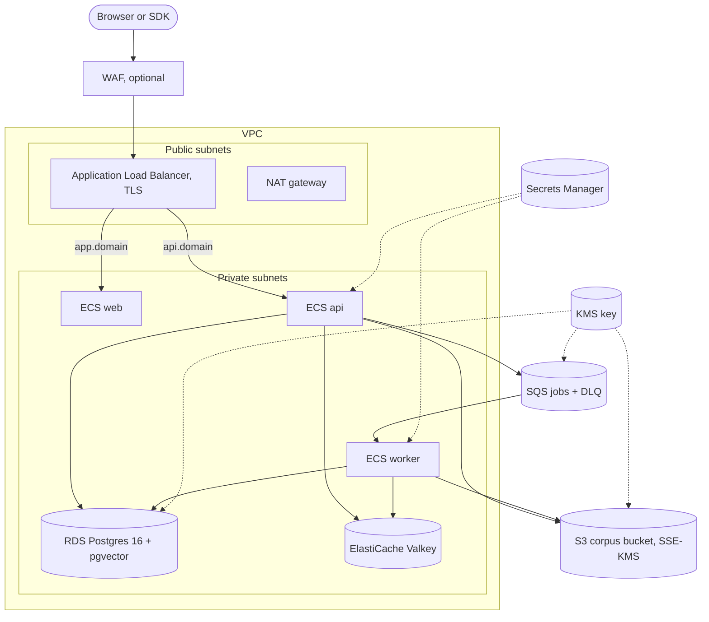

# High-Level Design

This document describes what Euron RAGKit is made of, how the pieces talk to each other, and
how the system behaves under load and failure. Module-level detail is in the
[Low-Level Design](LLD.md), the tables in the [Data Model](data-model.md), and the reasoning
behind each major choice in the [ADRs](adr/README.md).

- [Product](#product)
- [Goals and non-goals](#goals-and-non-goals)
- [Domain concepts](#domain-concepts)
- [System context](#system-context)
- [Containers](#containers)
- [Component responsibilities](#component-responsibilities)
- [Main flows](#main-flows)
- [API surface](#api-surface)
- [Deployment topology](#deployment-topology)
- [Scalability](#scalability)
- [Availability and failure modes](#availability-and-failure-modes)
- [Security summary](#security-summary)
- [Observability](#observability)
- [Key design decisions](#key-design-decisions)

## Product

RAGKit is a developer platform for retrieval-augmented generation. A team uses it to
**build** retrieval pipelines over its own content, **measure** them against an evaluation
set, and **serve** the winning pipeline to applications through an HTTP API and a Python
SDK.

It is not a chat app. The people who use it are engineers who own a RAG feature in their
product and need to answer three questions with evidence instead of intuition:

1. *Which chunking, embedding and retrieval settings work best for our content?*
2. *Did this change make retrieval better or worse, and on which questions?*
3. *Can CI stop a regression before it ships?*

So RAGKit treats a pipeline as a versioned, immutable configuration, treats an evaluation
run as a reproducible experiment, and treats "better" as numbers computed the same way
every time.

## Goals and non-goals

**Goals**

| # | Goal | How it is met |
| - | ---- | ------------- |
| G1 | Ingest real content from files, URLs and raw text | Loaders for uploads (stored in S3), URLs (SSRF-guarded fetch, snapshot kept in S3) and JSON text; parsers for PDF, Word, Markdown, HTML, text and CSV |
| G2 | Make every ingestion choice configurable and comparable | Pipeline versions: cleaning rules, three chunking strategies (fixed tokens, recursive by structure, sentence windows), embedding model; immutable once created |
| G3 | Retrieval that is good out of the box and tunable | pgvector HNSW vector search, Postgres full-text search, RRF or weighted fusion, metadata filters, a local cross-encoder reranker with a deterministic lexical fallback |
| G4 | Answers that can be checked | Cited answers from a deterministic extractive answerer offline, or OpenAI-compatible and Ollama models; citations verified against the passages given |
| G5 | Measure retrieval and answers with stable, explainable metrics | Datasets of questions with expected sources and reference answers; hit rate@k, MRR, nDCG, context precision and recall, faithfulness, answer relevance and correctness, all deterministic; an optional model-graded mode |
| G6 | Compare experiments, and gate CI on them | Runs stored with a full configuration snapshot; side-by-side comparison with per-question deltas; a CLI that exits non-zero when metrics regress past thresholds |
| G7 | Serve pipelines to applications | Project API keys, a REST API, a typed Python SDK, Redis caching, rate limits, query analytics |
| G8 | Runnable on a laptop without an AWS account or a paid model | Floci emulates S3, SQS, KMS and Secrets Manager, provisioned by the same Terraform as AWS; local embedding and reranking models ship in the image |

**Non-goals**

- **An end-user chat product.** There are no conversations or chat history; applications
  build their own UX on top of the query and answer endpoints.
- **Agent orchestration.** RAGKit retrieves and answers; tool use and planning belong to the
  caller.
- **Training or fine-tuning models.** Embedding and reranking models are used as published.
- **Arbitrary vector databases.** Postgres with pgvector is the one index store (ADR-0001).

## Domain concepts



| Concept | What it is |
| ------- | ---------- |
| **Project** | The unit of tenancy: members with roles (owner, editor, viewer) and API keys. Every row below belongs to exactly one project. |
| **Collection** | A corpus with its own documents, pipeline versions and datasets, for example "Developer docs". One version is *active*: queries use it unless they name another. |
| **Document** | One source: an uploaded file, a fetched URL or a block of text, with free-form JSON metadata and an optional `external_id` that evaluation datasets use to refer to it. Parsed once into sections. |
| **Pipeline version** | An immutable, numbered configuration: cleaning, chunking, embedding, retrieval defaults and the answerer. Changing anything means creating version N+1. |
| **Index** | The materialization of a version's *index settings* (cleaning, chunking, embedding) over the collection's documents. Identified by a fingerprint of those settings, so versions that only change retrieval or answering share one index and need no rebuild. |
| **Chunk** | A retrievable passage in one index: text, optional sentence-window context, heading path, location, inherited metadata, an embedding and a full-text vector. |
| **Dataset** | Questions for one collection, each with expected sources (a document `external_id` plus an optional evidence quote) and an optional reference answer. |
| **Evaluation run** | One dataset measured against one pipeline version, with optional retrieval overrides. Stores the configuration snapshot, per-question results and aggregate metrics. A dataset can name one run as its *baseline*. |

## System context

C4 level 1: RAGKit and the actors around it.



## Containers



| Container | Technology | Responsibility |
| --------- | ---------- | -------------- |
| **web** | Next.js 16 (standalone), React 19, TanStack Query | The dashboard: collections, documents, pipeline versions and their chunks, the retrieval playground, datasets, evaluation runs and comparisons, project settings and API keys. Reads its API URL at runtime from `/env.js`, so one image serves every environment. |
| **api** | Python 3.12, FastAPI, SQLAlchemy 2 (async) | Authentication, projects, ingestion intake, pipeline management, the query and answer endpoints, datasets, evaluation runs, comparisons and gates, analytics. Applies migrations on boot under an advisory lock. |
| **worker** | Same image, `python -m ragkit_server.worker` | Consumes the jobs queue: parses documents, builds index entries (clean, chunk, embed, write), runs evaluations. Extends message visibility while it works, drains on SIGTERM. |
| **Postgres** | PostgreSQL 16 with pgvector 0.8 | All state, the vector index (HNSW) and the full-text index (GIN). |
| **Valkey** | Valkey 8 (Redis protocol) | Embedding cache, query result cache, rate limits, revoked sessions, worker leader election. |
| **S3** | S3 with SSE-KMS (Floci locally) | Original uploads and URL snapshots, so any document can be re-parsed and any index rebuilt. |
| **SQS** | Standard queue with a redrive policy (Floci locally) | Parse, index and evaluation jobs; poison messages land in the dead-letter queue after three receives. |

## Component responsibilities

Inside the API process (see the [LLD](LLD.md) for modules):

| Component | Responsibility |
| --------- | -------------- |
| `api/routes` | URLs, request and response models, the access dependency. Nothing else. |
| `services` | Business rules and transactions: ingestion intake, pipeline versioning and index reuse, retrieval orchestration, answering, evaluation, gates, analytics, access control. |
| `repositories` | The only database access. Every method that reads project data takes the project id. |
| `ingestion` | Pure: file sniffing, parsers, cleaning rules, the three chunkers. |
| `retrieval` | Pure: fusion (RRF, weighted), the metadata filter compiler, rerankers, context packing. |
| `ai` | Token counting, embedding providers behind one interface, answerers (extractive, OpenAI-compatible, Ollama), citations, the model judge. |
| `evaluation` | Pure: relevance judging, retrieval and answer metrics, aggregation, the regression gate. |
| `integrations` | S3 or local storage, the SQS or inline job queue, the SSRF-guarded URL fetcher. |

## Main flows

### 1. Ingest a document



Parsing happens once per document; each index then derives its own chunks from the stored
sections. A duplicate message is harmless: both jobs are idempotent and keyed by ids.

### 2. Create a pipeline version

The API validates the configuration, numbers the version, and computes the **index
fingerprint**: a SHA-256 of the canonical index settings (cleaning, chunking, the resolved
embedding model and dimension) plus the indexer's own version. If an index with that
fingerprint exists in the collection, the new version points at it and is queryable
immediately. Otherwise a new index is created with one entry per document and the worker
builds it in the background; the dashboard shows progress per document. Activation is a
separate, explicit step.

### 3. Query and answer



The request may override any retrieval default of the version (mode, k, candidate count,
fusion, rerank) and add metadata filters. Retrieval results are cached in Valkey under a key
that includes the collection's corpus version, so a document change retires every cached
result without a scan. Each call is logged (latency, hit count, cache hit) for the analytics
view.

### 4. Evaluate and compare

An evaluation run is queued like any other job. The worker answers every question of the
dataset with the run's configuration, without the result cache, and records for each
question the retrieved chunks with their relevance judgment, the answer, its citations,
every metric and the latency. Aggregates are means over the questions a metric applies to,
plus per-tag breakdowns and latency percentiles. Comparing runs aligns their questions and
reports metric deltas and the questions that improved or regressed.

### 5. Gate CI on a regression

```bash
ragkit eval gate support-golden --version 3 \
  --min hit_rate=0.85 --max-drop 0.02 --report gate.md
```

The CLI starts a run, waits for it, asks the API to check it against absolute floors and
against the dataset's baseline run, prints a table, writes a Markdown report and exits with
0 (pass), 1 (regression) or 2 (the run could not be evaluated).

## API surface

All routes are under `/api/v1`, JSON in and out, with the error envelope
`{"error": {"code", "message", "request_id", "details?"}}` and an `X-Request-Id` header on
every response. Lists are paginated with `limit` and `offset`.

| Area | Routes |
| ---- | ------ |
| Auth | `POST /auth/login`, `POST /auth/signup`, `POST /auth/logout`, `GET /auth/me` |
| Projects | `GET, POST /projects`, `GET, PATCH, DELETE /projects/{p}`, members, API keys, activity |
| Collections | `GET, POST /projects/{p}/collections`, `GET, PATCH, DELETE .../collections/{c}` |
| Documents | `GET, POST .../collections/{c}/documents`, `POST .../documents/import`, `GET, PATCH, DELETE .../documents/{d}`, `POST .../documents/{d}/reprocess` |
| Pipelines | `GET, POST .../collections/{c}/pipelines`, `GET .../pipelines/{n}`, `POST .../pipelines/{n}/activate`, `GET .../pipelines/{n}/chunks`, `POST .../pipelines/preview` |
| Retrieval | `POST .../collections/{c}/query`, `POST .../collections/{c}/answer` |
| Evaluation | `GET, POST /projects/{p}/datasets`, items and JSONL import, `GET, POST /projects/{p}/eval-runs`, `GET .../eval-runs/{r}`, `GET .../eval-runs/{r}/results`, `GET .../eval-runs/compare`, `POST .../eval-runs/{r}/gate`, `POST .../eval-runs/{r}/baseline` |
| Analytics | `GET /projects/{p}/analytics` |
| System | `GET /system/info`, `GET /livez`, `GET /readyz`, `GET /metrics` |

The full reference is generated from the code: [docs/api/openapi.json](../api/openapi.json).

## Deployment topology

`infra/terraform/modules/deployment` builds one complete deployment on AWS; `envs/aws-dev`
and `envs/aws-prod` call it with different sizes and safety switches, and
`envs/local-floci` applies the data-plane modules to the emulator.



| | aws-dev | aws-prod |
| --- | --- | --- |
| Availability zones | 2, one NAT | 3, NAT per zone |
| Database | single-AZ, 3-day backups | Multi-AZ, 14-day backups, deletion protection |
| Cache | one node | primary + replica, automatic failover |
| Edge | load balancer | load balancer + WAF |
| Scaling | api 1 to 2, worker 1 to 2, web 1 to 2 | api 2 to 6, worker 2 to 6, web 2 to 4 |
| Logs | 14 days | 365 days, KMS-encrypted |

## Scalability

- **Stateless API.** Any number of API tasks run behind the load balancer; sessions are
  signed tokens, revocation lives in Valkey, and caches are shared.
- **Indexing scales with workers.** Jobs are per (index, document), so a large collection is
  built in parallel across workers; each worker bounds its own concurrency.
- **Vector search stays fast with filters.** HNSW indexes are partial per embedding width,
  and pgvector 0.8 iterative scans keep filtered queries (by index, by metadata) from
  starving the result list.
- **Repeated work is cached.** Embeddings are cached by model and text hash, so re-indexing
  unchanged text with the same model costs a Valkey round trip; retrieval results are cached
  per corpus version.
- **Evaluations are bounded.** A run is one job processed sequentially per question, so a
  large dataset cannot monopolise a worker's connection pool; runs execute in parallel
  across workers.

## Availability and failure modes

| Failure | Behaviour |
| ------- | --------- |
| Worker crashes mid-job | The SQS message becomes visible again after its timeout and is retried; the job is idempotent. A stale-entry reaper re-enqueues index entries stuck in `processing`. |
| A document cannot be parsed | Marked `failed` with a message safe to show the uploader; other documents and indexes are unaffected. |
| A job fails three times | SQS moves it to the dead-letter queue; the row is marked failed with the reason. |
| Model provider down | Model answers return `502 upstream_error`; the extractive answerer and every retrieval path keep working. A model judge falls back to deterministic grading and records it. |
| Cross-encoder model unavailable | Reranking falls back to the lexical reranker and the response says so (`rerank.fallback`). |
| Valkey down | Caches are bypassed (read-through); rate limiting fails closed for sign-in (503) and open for queries, ingestion and runs. Cookie sessions cannot be checked against the sign-out list, so they are refused; API keys keep working. |
| Index still building | Queries run against what is indexed so far and report `index_status: building`. |
| Rolling deploy | uvicorn drains in-flight requests; the worker stops receiving, finishes in-flight jobs within a 90 second grace period and hands any still running back to the queue at once, inside ECS's 120 second stop timeout. |

## Security summary

- **Project isolation** is structural: the access dependency resolves the caller's role in
  the project before any route runs, non-members get 404, and every repository query filters
  by project. An integration sweep calls every project route as an outsider.
- **Credentials**: Argon2id passwords, HS256 session tokens with a revocable `jti` and a
  per-user session version, project API keys stored as a peppered HMAC, roles enforced in
  the API.
- **URL loader**: http and https only, DNS resolved and private, loopback, link-local and
  metadata ranges refused (re-checked on every redirect), size and time limits.
- **Uploads**: the extension picks the parser and the magic bytes must agree; size and page
  limits; files are stored under generated keys, never user paths.
- **Data at rest**: S3, SQS, RDS, Valkey, Secrets Manager and logs encrypted with one
  customer-managed KMS key; TLS everywhere on AWS.

Details: [security](security.md) and the [threat model](threat-model.md).

## Observability

- **Logs**: structlog JSON lines with a request id on every line and every response.
- **Metrics** at `/metrics` (Prometheus, answered with 404 by the public load balancer): HTTP rate and latency by route template, retrieval
  stage latencies (embed, vector, keyword, fusion, rerank), cache hit ratios, documents
  parsed and indexed, evaluation runs by outcome, queue backlog.
- **Analytics** in the product: queries per day, p50 and p95 latency, zero-hit rate and top
  queries per project and collection.
- **AWS**: CloudWatch alarms on 5xx rate, latency, unhealthy targets, CPU, database storage,
  queue age and dead-letter messages, plus a dashboard.

## Key design decisions

| ADR | Decision |
| --- | -------- |
| [0001](adr/0001-postgres-and-pgvector-as-the-index.md) | Postgres with pgvector is the only index store: vectors, full text and metadata in one transactional database |
| [0002](adr/0002-immutable-pipeline-versions-and-shared-indexes.md) | Pipeline versions are immutable; indexes are shared by fingerprint of the index settings |
| [0003](adr/0003-evidence-based-relevance.md) | Evaluation judges relevance by expected document plus evidence text, so metrics compare across chunking strategies |
| [0004](adr/0004-deterministic-providers-first.md) | Deterministic local providers for embeddings, reranking, answers and grading; model adapters behind the same interfaces |
| [0005](adr/0005-floci-for-local-aws.md) | Floci emulates AWS locally, provisioned by the same Terraform as production |
| [0006](adr/0006-one-queue-for-parse-index-and-eval-jobs.md) | One SQS queue with a dead-letter queue carries parse, index and evaluation jobs |
