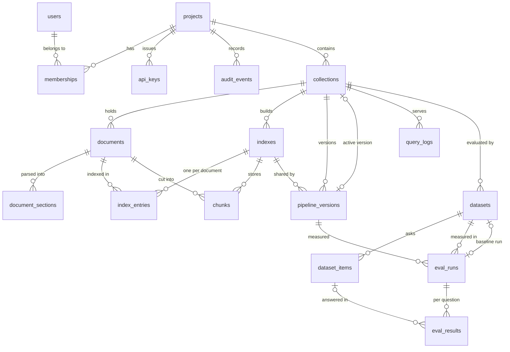

# Data Model

Every table, why it exists, and the indexes behind the hot queries. The schema is created by
one Alembic revision (`apps/api/src/ragkit_server/migrations/versions/0001_initial_schema.py`)
that the API applies on boot under an advisory lock. PostgreSQL 16 with the `vector`
(pgvector 0.8) and `citext` extensions.

- [Entity relationships](#entity-relationships)
- [Conventions](#conventions)
- [Accounts and access](#accounts-and-access)
- [Corpus](#corpus)
- [Pipelines and indexes](#pipelines-and-indexes)
- [Serving](#serving)
- [Evaluation](#evaluation)
- [Index catalogue](#index-catalogue)
- [Deletion and retention](#deletion-and-retention)

## Entity relationships



## Conventions

- Primary keys are time-ordered UUIDs (version 7) generated by the application
  (`core/ids.py`): inserts land in roughly increasing key order, so the hot B-tree pages stay
  in cache as tables grow. Composite keys where the pair is the identity (`memberships`,
  `index_entries`).
- Every row that belongs to a project carries `project_id` (directly or through its parent),
  and every repository method that reads project data filters by it. Isolation does not rely
  on a route remembering to check.
- Timestamps are `timestamptz`, set by the database (`created_at`, `updated_at`).
- Free-form data is JSONB with a database default (`'{}'` or `'[]'`), validated by Pydantic
  models before it is written.
- Status columns are short strings with `CHECK` constraints rather than Postgres enums, so a
  new status is a constraint change, not a type migration.
- Foreign keys say what happens on delete: `CASCADE` for owned rows, `SET NULL` for
  references to people, keys and optional links.

## Accounts and access

### users

| Column | Type | Notes |
| ------ | ---- | ----- |
| `email` | citext, unique | case-insensitive sign-in |
| `name` | varchar(120) | |
| `password_hash` | text | Argon2id |
| `is_admin` | bool | the first account of a deployment |
| `session_version` | int | bumped by a password change: every older session token is refused |
| `failed_logins`, `locked_until` | int, timestamptz | per-account lockout after repeated failures |
| `last_login_at` | timestamptz | |

### projects, memberships

`projects(slug unique, name, description, created_by)`: the unit of tenancy. Routes accept
the slug or the id.

`memberships(project_id, user_id, role)` with `role IN ('owner', 'editor', 'viewer')`. The
primary key `(project_id, user_id)` answers "what is this person's role here"; the secondary
index on `user_id` lists a person's projects. The service refuses to remove or demote the last
owner (`last_owner`).

### api_keys

| Column | Notes |
| ------ | ----- |
| `prefix` | unique, the 10 lowercase base32 characters shown in the dashboard (`rgk_<prefix>_...`) |
| `secret_hash` | `HMAC-SHA256(API_KEY_PEPPER, secret)`; the secret itself is never stored |
| `role` | `viewer` or `editor` (keys never own a project) |
| `last_used_at` | written at most once a minute per key (a Valkey flag throttles it) |
| `expires_at`, `revoked_at` | either one disables the key |

### audit_events

`(project_id, actor_user_id, actor_api_key_id, action, target_type, target_id, details,
created_at)`: who changed what. Actions are dotted names such as `pipeline.created`,
`document.added`, `eval_run.baseline_set`, `api_key.revoked`. `details` never holds secrets
or document text. Read newest first through `(project_id, created_at)`.

## Corpus

### collections

`(project_id, slug, name, description, active_version_id, corpus_version)`, unique
`(project_id, slug)`.

- `active_version_id` points at the pipeline version queries use by default. The foreign key
  is added after `pipeline_versions` exists (the two reference each other).
- `corpus_version` increments whenever chunks of the collection change (an index entry
  finishes, a document is deleted). It is part of every query cache key, so cached results
  retire themselves without a scan.

### documents

| Column | Notes |
| ------ | ----- |
| `external_id` | unique per collection; how datasets refer to a document (defaults to the file name stem or a slug of the title) |
| `source_type` | `file`, `url` or `text` |
| `source_uri` | original file name or the URL |
| `kind` | detected parser: `pdf`, `docx`, `md`, `html`, `txt`, `csv` |
| `sha256` | content hash; a partial unique index makes the same bytes in one collection one document |
| `storage_key` | `projects/<p>/collections/<c>/documents/<d>/original<ext>` in S3 (or the local store) |
| `metadata` | JSONB copied onto every chunk, so filters work at query time without a join |
| `status`, `error`, `attempts` | the parse job's state machine: `queued`, `processing`, `ready`, `failed` |
| `section_count`, `token_count`, `parsed_at` | filled by the parse job |

Partial unique indexes: `(collection_id, sha256) WHERE source_type IN ('file', 'text')` and
`(collection_id, source_uri) WHERE source_type = 'url'`. A small partial index on
`updated_at WHERE status IN ('queued', 'processing')` is all the stale-work reaper scans.

### document_sections

`(document_id, ordinal, kind, label, blocks, text, token_count)`, unique
`(document_id, ordinal)`. A section is a PDF page, the part of a document under a top-level
heading, or a table. `blocks` keeps the parsed structure (paragraphs, headings with levels,
list items, table rows) so every index can re-chunk without re-parsing the original.

## Pipelines and indexes

### pipeline_versions

`(collection_id, version, name, description, config, index_id, created_by, created_at)`,
unique `(collection_id, version)` and `CHECK (version >= 1)`. Immutable after creation: a
change is version N+1. `config` is the full validated configuration (cleaning, chunking,
embedding, retrieval, answer); `index_id` points at the index whose fingerprint matches the
version's index settings.

### indexes

`(collection_id, fingerprint, config, embedding_model, embedding_dim)`, unique
`(collection_id, fingerprint)`. `config` holds only the index settings that were
fingerprinted, so it explains exactly what the chunks were built with. Two versions that only
differ in retrieval or answering share one row (ADR-0002).

### index_entries

The unit of indexing work: one row per (index, document), primary key `(index_id,
document_id)`, with `status`, `chunk_count`, `token_count`, `attempts`, `error` and
`duration_ms`. An index's status and progress are aggregated from its entries. Indexed by
`document_id` (a document's indexes on its detail page) and by `updated_at` for unfinished
rows (the reaper).

### chunks

| Column | Notes |
| ------ | ----- |
| `index_id`, `collection_id`, `document_id` | the chunk belongs to one index of one collection |
| `ordinal`, `section_ordinal` | position in the document and the section it came from |
| `heading` | heading path, for example `Webhooks > Verifying signatures` |
| `location` | the section it came from, as a person would cite it: `Page 3`, a heading, a table |
| `text` | what is embedded and keyword-indexed |
| `context` | the sentence window for `sentence_window` chunks (what answerers and the relevance judge read), otherwise null |
| `char_start`, `char_end`, `token_count` | |
| `metadata` | the document's metadata at write time |
| `embedding` | an untyped `vector` column with `embedding_dim`; `CHECK (vector_dims(embedding) = embedding_dim)` and `embedding_dim IN (384, 768, 1024, 1536)` |
| `tsv` | `to_tsvector('english', heading || ' ' || text)`, a stored generated column |

The vector column is untyped so one table holds every embedding width. Each supported width
has its own partial HNSW index over a cast expression:

```sql
CREATE INDEX ix_chunks_embedding_hnsw_384 ON chunks USING hnsw
  ((embedding::vector(384)) vector_cosine_ops) WITH (m = 16, ef_construction = 64)
  WHERE embedding_dim = 384;
```

Queries repeat the same cast and the same width predicate as SQL literals (never bound
parameters), so the planner matches the partial index on every execution. A new width is a
new migration with its own index.

## Serving

### query_logs

One row per served query or answer: `(project_id, collection_id, pipeline_version, kind,
mode, rerank, top_k, hit_count, top_score, latency_ms, cached, answerer, query_hash,
query_text, user_id, api_key_id, created_at)`. `query_text` is kept for the top-queries view
unless `QUERY_LOG_TEXT=false`; grouping uses `query_hash`. The analytics view reads it through
`(project_id, created_at)` and `(collection_id, created_at)`, always bounded to a window of
at most 90 days.

## Evaluation

### datasets, dataset_items

`datasets(project_id, collection_id, slug, name, description, gate, baseline_run_id)`,
unique `(project_id, slug)`. `gate` stores the release thresholds:
`{"min": {"hit_rate": 0.85}, "max_drop": 0.03}`. `baseline_run_id` is the run new runs are
compared and gated against.

`dataset_items(dataset_id, ordinal, question, expected_sources, expected_answer, tags)`.
`expected_sources` is `[{"document": "<external_id>", "evidence": "<quote or null>"}]`; the
API refuses an item that names a document the collection does not have
(`unknown_documents`). Read in order through `(dataset_id, ordinal)`.

### eval_runs

| Column | Notes |
| ------ | ----- |
| `dataset_id`, `collection_id`, `pipeline_version_id` | what was measured |
| `label` | given, or generated from the version and overrides (`v2 recursive, hybrid + cross-encoder`) |
| `config` | the full effective configuration snapshot, including overrides and `evaluation: {k, grader, answers}` |
| `k`, `grader` | `CHECK (k BETWEEN 1 AND 50)`, `grader IN ('deterministic', 'model')` |
| `status`, `total_items`, `completed_items`, `attempts`, `error` | progress of the eval job |
| `metrics` | aggregates: `means`, `counts`, `questions`, `failed`, `latency_ms {p50, p95, mean}`, `by_tag` |
| `started_at`, `finished_at` | |

Indexed by `(project_id, created_at)` and `(dataset_id, created_at)` for the runs lists, by
`pipeline_version_id`, and by `updated_at` for unfinished runs (the reaper).

### eval_results

One row per question of a run, unique `(run_id, item_id)` so a retried run resumes by upsert:
`question`, `tags`, `retrieved` (rank, chunk, document, location, a passage preview, score,
`relevant` and the expected sources it `covers`), `answer`, `citations`, `metrics`,
`grading`, latencies and `error`. Results copy the question and tags, so a run stays readable
after its dataset is edited (`item_id` becomes null when the item is deleted).

## Index catalogue

| Query | Index |
| ----- | ----- |
| A person's projects | `ix_memberships_user_id` |
| Activity, newest first | `ix_audit_events_project_id_created_at` |
| Documents of a collection, newest first | `ix_documents_collection_id_created_at` |
| Duplicate upload or URL | `uq_documents_collection_id_sha256`, `uq_documents_collection_id_source_uri` (partial) |
| Stale work | `ix_documents_unfinished`, `ix_index_entries_unfinished`, `ix_eval_runs_unfinished` (partial) |
| Chunks of a document in an index, in order | `ix_chunks_index_id_document_id_ordinal` |
| Vector search | `ix_chunks_embedding_hnsw_{384,768,1024,1536}` (partial HNSW) |
| Keyword search | `ix_chunks_tsv` (GIN) |
| Metadata filters | `ix_chunks_metadata` (GIN, `jsonb_path_ops`, serves `@>`) |
| Analytics | `ix_query_logs_project_id_created_at`, `ix_query_logs_collection_id_created_at` |
| Runs lists | `ix_eval_runs_project_id_created_at`, `ix_eval_runs_dataset_id_created_at` |
| A run's questions in order | `ix_eval_results_run_id_ordinal` |

## Deletion and retention

- Deleting a **project** cascades to everything it owns; the API then deletes its objects
  from storage under `projects/<p>/`.
- Deleting a **collection** cascades to documents, sections, indexes, entries, chunks,
  versions, datasets, runs and results.
- Deleting a **document** removes its chunks from every index (cascade), bumps the
  collection's `corpus_version` and deletes the original from storage.
- **Runs** are deleted only on request (finished runs only). A dataset's baseline link is
  cleared when its run is deleted (`SET NULL`).
- **Query logs** grow with traffic; an operator prunes them by `created_at` (see
  [operations](../guides/operations.md)).
- S3 keeps superseded object versions for 90 days in AWS environments
  (`noncurrent_version_days`), then expires them.
