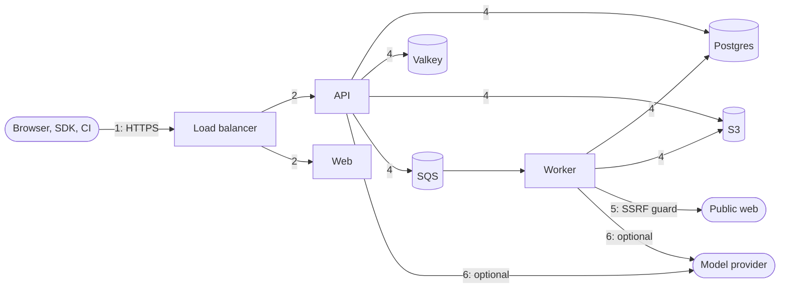

# Threat Model

A STRIDE analysis of RAGKit as deployed by `infra/terraform` (and run locally by
`make up`). Controls are described in detail in [security.md](security.md); this document
lists what an attacker could try, where, and what stops them.

- [Assets](#assets)
- [Actors](#actors)
- [Trust boundaries](#trust-boundaries)
- [Data flow](#data-flow)
- [STRIDE analysis](#stride-analysis)
- [Residual risks](#residual-risks)
- [Review triggers](#review-triggers)

## Assets

| Asset | Why it matters |
| ----- | -------------- |
| Ingested corpora (originals, sections, chunks) | Often internal documentation; disclosure across projects is the worst outcome |
| Evaluation datasets and results | Encode what the team considers correct; tampering silently corrupts release decisions |
| Pipeline versions and the active marker | Control what every application receives; tampering degrades or poisons answers |
| Accounts, sessions, API keys | Grant access to all of the above |
| Query logs | Reveal what users of the customer's product ask |
| Infrastructure credentials and keys | KMS key, database and cache secrets, the session secret and API key pepper |

## Actors

| Actor | Access | Intent considered |
| ----- | ------ | ----------------- |
| Anonymous internet user | the public load balancer | account takeover, enumeration, denial of service, SSRF through the API |
| Member of another project | a valid account | read or change a project they do not belong to |
| Viewer or editor of a project | a valid role | exceed their role (an editor managing keys, a viewer ingesting) |
| Holder of a leaked API key | the key | use it beyond its project or role, after revocation |
| Author of an ingested document or web page | content that RAGKit reads | prompt injection, parser exploits, SSRF via redirects |
| Compromised dependency or container | code execution in a task | reach other services, steal secrets |
| Operator with AWS access | the account | out of scope as an adversary; their mistakes are in scope |

## Trust boundaries

1. **Internet to load balancer**: TLS, WAF (when enabled), host rules, `/metrics` blocked.
2. **Load balancer to tasks**: private subnets; only the load balancer's security group may
   reach the API and web ports.
3. **Browser to API**: cookie or bearer authentication, CORS, CSRF origin check.
4. **API and worker to data stores**: security groups, TLS, credentials from Secrets
   Manager, IAM scoped to one bucket prefix and one queue.
5. **Worker to the public web** (URL sources): the SSRF guard.
6. **RAGKit to model providers** (optional): outbound HTTPS; sources are untrusted input to
   the model.
7. **Document content to parsers and models**: everything ingested is untrusted.

## Data flow

## STRIDE analysis

### Spoofing

| Threat | Target | Mitigation |
| ------ | ------ | ---------- |
| Password guessing or credential stuffing | sign-in | 10 attempts per minute per address, 15-minute lockout after 8 failures, Argon2id, same error and cost for unknown accounts; sign-in refuses (503) rather than runs unthrottled when Valkey is down |
| Forged session token | API | HS256 signature with a 32+ character secret checked at startup; `exp`, `iat`, `sub`, `jti` required |
| Replay of a signed-out token | API | `jti` denylist until expiry; session version bump on password change; sessions refused when the denylist cannot be read |
| Guessed or brute-forced API key | API | 256 bits of secret, peppered HMAC, constant-time compare, per-key rate limits |
| Spoofed client address to dodge limits | rate limiter | `X-Forwarded-For` trusted only from the VPC range |

### Tampering

| Threat | Target | Mitigation |
| ------ | ------ | ---------- |
| Cross-site request from another origin with the session cookie | state-changing routes | `SameSite=Lax` cookie plus an origin check on unsafe methods |
| Editing another project's data | every project route | access dependencies before every route, project-filtered repositories, the outsider sweep test |
| Silent change to what production serves | pipeline versions | versions are immutable; activation is an explicit, audited action by an editor or owner |
| Tampering with evaluation evidence | runs and results | results are written by the worker only; runs cannot be edited, only deleted (audited); baseline changes are audited |
| Modified message on the queue | worker | messages carry ids only; the worker reloads every row from the database and re-checks its state |
| Infrastructure drift | AWS | Terraform with checkov and tflint in CI; KMS key policy and IAM least privilege |

### Repudiation

| Threat | Mitigation |
| ------ | ---------- |
| "I did not activate that version" | audit events record the person or key for every data-changing action, with time and details |
| Unattributed API traffic | query logs record the key or person behind every query and answer |
| Missing request context | a request id on every log line and response; uvicorn access logs replaced by structured request logs |

### Information disclosure

| Threat | Target | Mitigation |
| ------ | ------ | ---------- |
| Reading another project's chunks through retrieval | query and answer | the index is resolved from the project's own collection; vector and keyword queries filter by `index_id` |
| Learning that a project exists | project routes | non-members get 404, not 403 |
| SSRF to the metadata service or the VPC | URL sources | DNS resolution with private, loopback, link-local and metadata ranges refused, redirects re-checked hop by hop, port allow-list |
| Cache entries leaking across projects | Valkey | every cache key includes the project id |
| Secrets in logs or responses | logs, errors | sensitive keys redacted; unexpected errors return a generic message with a request id |
| Metrics revealing internals | `/metrics` | blocked on the public load balancer |
| Data at rest | S3, RDS, Valkey, SQS, logs | encrypted with a customer-managed KMS key; TLS in transit |
| Prompt injection exfiltrating other sources | model answers | a model only sees the current query's sources; no tools; citations limited to given sources |

### Denial of service

| Threat | Target | Mitigation |
| ------ | ------ | ---------- |
| Request floods | API | per-principal limits, optional WAF rate rule, autoscaling |
| Huge or decompression-bomb uploads | API, worker | body cap in middleware, per-file size limit, page and text limits in parsers, parse in a worker thread per job |
| Slow or endless URL downloads | worker | 20 second timeout, size cap, redirect limit |
| Expensive retrieval requests | database | `top_k` at most 50, candidates at most 200, filter depth and size limits, HNSW `ef_search` bounded |
| Poison jobs | worker | three attempts, then the dead-letter queue; alarms on DLQ messages and queue age |
| Long evaluations starving ingestion | worker | bounded concurrency per worker, runs processed question by question, autoscaling on CPU |

### Elevation of privilege

| Threat | Target | Mitigation |
| ------ | ------ | ---------- |
| Viewer or editor performing owner actions | members, keys, deletion | role checks in the access dependency; keys can never exceed editor |
| Removing the last owner to orphan a project | members | refused (`last_owner`) |
| Container escape or lateral movement | ECS | non-root, read-only root file system, no privileged mode, task roles limited to one bucket prefix and one queue |
| Malicious file triggering code execution in a parser | worker | pure-Python parsers (`pypdf`, `python-docx`, BeautifulSoup) without shelling out; the worker's IAM role cannot reach anything beyond its data stores |

## Residual risks

- **Prompt injection cannot be fully prevented** with model answerers. Fencing, citation
  verification and evaluation reduce it; teams that ingest untrusted public content should
  prefer the extractive answerer or review faithfulness regularly.
- **The fixed-window rate limiter** allows a short burst at a window boundary.
- **Shared indexes inside a project** are by design: anyone who can query a collection can
  retrieve any of its chunks. Separate audiences belong in separate collections or projects.
- **The emulator is not AWS**: IAM evaluation and some edge cases are only exercised on a
  real account (`make up-aws`, `aws-dev`).
- **Query text is stored** for analytics unless `QUERY_LOG_TEXT=false`.

## Review triggers

Revisit this model when adding: a new source type or parser, a tool-using model feature,
cross-project sharing, a new public endpoint without project scope, or a change to how
sessions or keys are issued.
