# Walkthrough

A guided tour of every screen with the demo data, ending with one experiment you can repeat
on your own content. Start the stack and seed it first ([quickstart](quickstart-local.md)),
then sign in at <http://localhost:3160> as `priya.raman@acme-payments.example` (the owner)
with the password `make demo` printed.

The demo project, **Acme Payments**, belongs to a fictional payments company with two RAG
features: a docs assistant over its developer documentation, and a support copilot over four
support playbooks. The seed ingests real files (Markdown, an HTML page, a CSV price list,
plain-text release notes, a PDF and a Word document), builds three pipeline versions of the
developer docs, imports three evaluation datasets, runs seven evaluations and replays two
weeks of query traffic. Everything on screen was computed by the real pipeline; only the
timestamps are spread over the past two weeks so the charts have a shape.

- [1. Overview](#1-overview)
- [2. Documents](#2-documents)
- [3. Pipeline versions](#3-pipeline-versions)
- [4. What a version indexed](#4-what-a-version-indexed)
- [5. A new version, with a live preview](#5-a-new-version-with-a-live-preview)
- [6. The playground](#6-the-playground)
- [7. Cited answers](#7-cited-answers)
- [8. Two versions side by side](#8-two-versions-side-by-side)
- [9. Evaluations](#9-evaluations)
- [10. A run](#10-a-run)
- [11. Comparing runs](#11-comparing-runs)
- [12. A dataset and its gate](#12-a-dataset-and-its-gate)
- [13. Analytics](#13-analytics)
- [14. API keys](#14-api-keys)
- [15. The dark theme](#15-the-dark-theme)
- [Try it as other people](#try-it-as-other-people)
- [An experiment to repeat](#an-experiment-to-repeat)

## 1. Overview

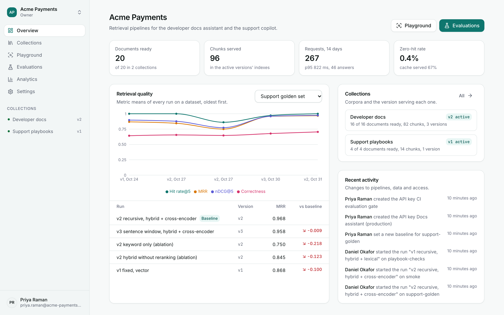

The project at a glance: documents ready, chunks in the active versions' indexes, requests in
the last 14 days with their p95 latency and how many were answers, the zero-hit rate (queries
where nothing came back) and the share served from the cache.

**Retrieval quality** is the heart of it: the metric means of every run on a dataset, oldest
first. Pick the dataset at the top right. Here the support golden set went from the v1
baseline (fixed windows, vector only), through two ablations of v2, to v2 with the
cross-encoder and v3 with sentence windows, and the table below lists each run's MRR against
the baseline. **Collections** shows which version serves each one, and **Recent activity** is
the audit trail.

## 2. Documents

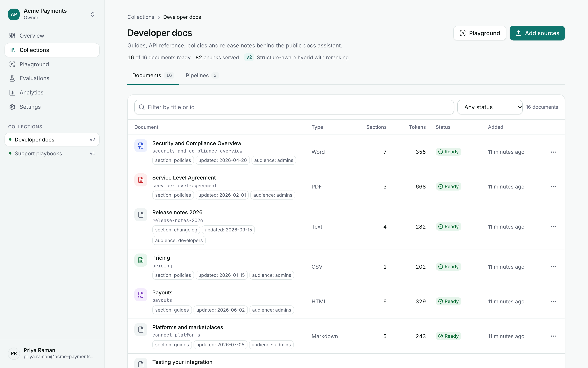

Open **Collections, Developer docs**. Sixteen documents in six formats, each with its type,
how many sections it was parsed into, its tokens, its status and the metadata the seed
attached (`section`, `audience`, `updated`), which is what the playground's metadata filter
works on. Open a document to see its parsed sections and, per pipeline version, whether it is
in that version's index. **Add sources** takes files, URLs or pasted text; the status moves
from queued to ready as the worker parses and indexes each one.

## 3. Pipeline versions

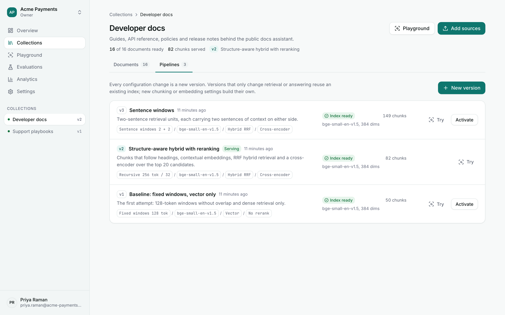

The **Pipelines** tab lists every version of the collection, newest first:

- **v1** is the baseline: 128-token windows without overlap and dense retrieval only.
- **v2** (serving) chunks by structure, embeds the heading with the text, fuses vector and
  keyword results with RRF and reranks the top 20 with the cross-encoder.
- **v3** retrieves two-sentence units and hands the answerer two sentences of context on each
  side.

Each row shows its stages as chips, the state of its index, how many chunks it holds and the
embedding model. **Try** opens the playground with that version; **Activate** makes it the one
queries use by default. A version is immutable: changing anything is a new version.

## 4. What a version indexed

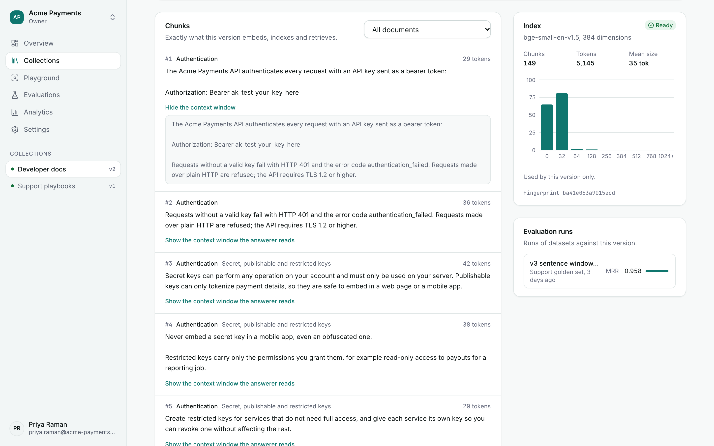

Open v3. Next to the configuration, the chunk browser lists exactly what the version embeds,
indexes and retrieves, with each chunk's heading path and token count. For a sentence-window
version, **Show the context window the answerer reads** reveals the wider span behind a small
retrieval unit. On the right: the index (chunks, tokens, mean size), a histogram of chunk
sizes, the index **fingerprint** (versions with the same index settings share one index), and
the evaluation runs made against this version.

## 5. A new version, with a live preview

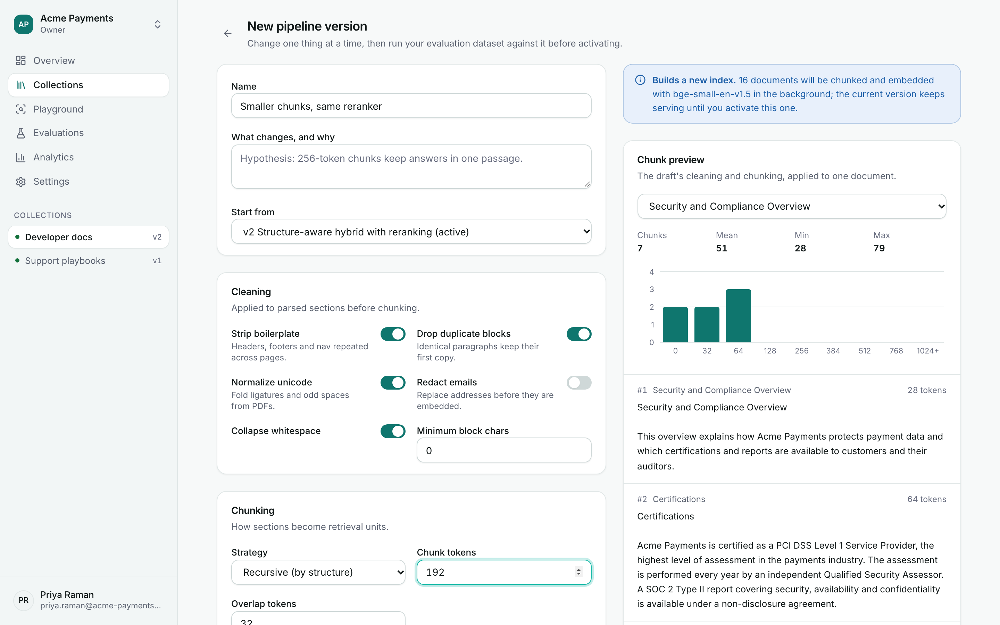

**New version** starts from an existing one. Change the chunk size and two things happen at
once. The blue notice tells you what the change costs: here "Builds a new index. 16 documents
will be chunked and embedded with bge-small-en-v1.5 in the background; the current version
keeps serving until you activate this one", where a change to only the reranker would say
"Reuses the index of v2".
And the preview chunks a document of your choice with the draft's cleaning and chunking, with
the size histogram and the chunks themselves, before anything is built. The form refuses
combinations that cannot work (an overlap above half the chunk size) and says why.

## 6. The playground

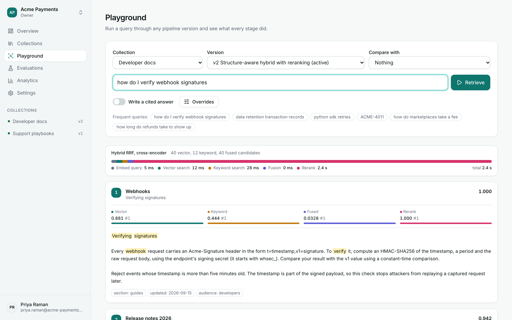

Pick a collection and a version, type `how do I verify webhook signatures` and press
**Retrieve**. The bar shows where the time went (embedding the query, the vector search, the
keyword search, the fusion, the rerank) and how many candidates each stage produced. Every
hit carries four scores and four ranks: its **vector** similarity, its **keyword** rank score,
its **fused** RRF score and its **rerank** score, drawn as bars on each stage's own scale,
with the matched words highlighted and the document's metadata underneath. A hit the reranker
moved says so ("1 by rerank"). **Overrides** changes any retrieval setting for one request
(mode, fusion, candidates, reranker) and takes a metadata filter, without creating a version.
The request lives in the URL, so a result can be shared and reloaded.

## 7. Cited answers

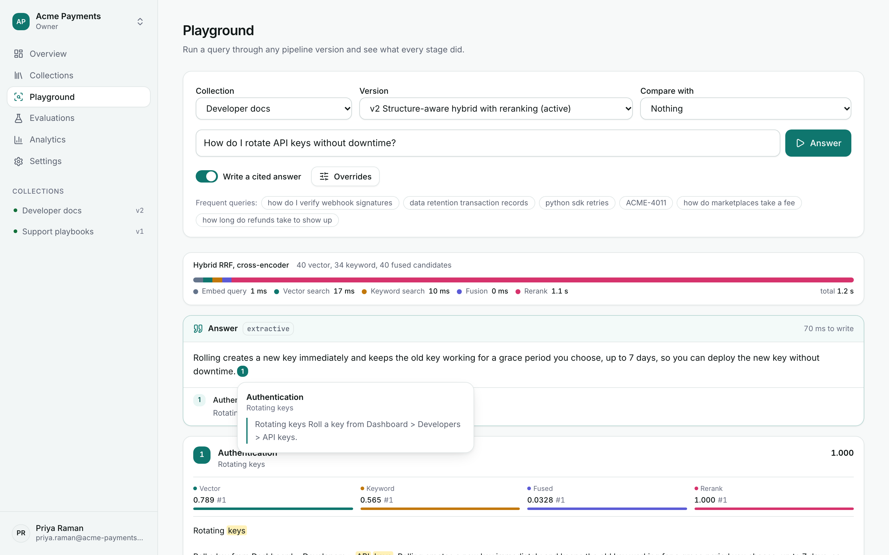

Switch on **Write a cited answer** and ask `How do I rotate API keys without downtime?`. With
no model configured, the built-in extractive answerer composes the answer from the retrieved
passages, offline; each claim carries a numbered citation. Press a citation to see the passage
it rests on. Citations are checked against the sources the answerer was given, and markers that
point anywhere else are removed. With `RAGKIT_LLM_PROVIDER` set, the same screen uses a model.

## 8. Two versions side by side

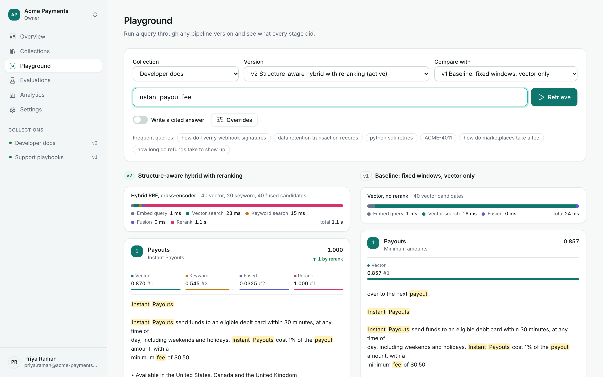

Set **Compare with** to v1 and search `instant payout fee`. The same query runs through both
versions. v2 puts the "Instant Payouts" section first (the keyword stage ranked it second, and
the cross-encoder lifted it to first), while v1's vector-only search leads with a different
passage. This is the quickest way to see what a change does to a query you care about; the
evaluations show what it does to all of them.

## 9. Evaluations

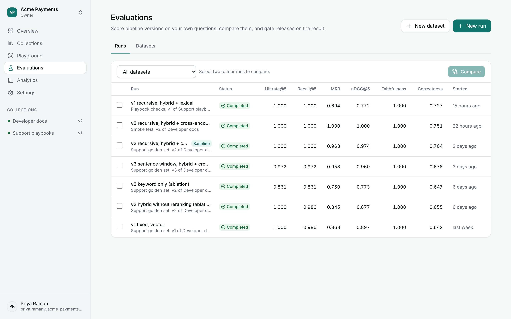

Seven runs, newest first, with their means: hit rate, recall, MRR, nDCG, faithfulness and
correctness. The v2 run on the support golden set is marked **Baseline**. The two ablations
(keyword only, and hybrid without reranking) are there to show what each stage earns: MRR drops
from 0.968 to 0.750 without vectors and reranking, and to 0.845 without the reranker alone.
Tick two to four runs and press **Compare**. **New run** starts a run of any dataset against
any version; the worker scores it while you watch.

## 10. A run

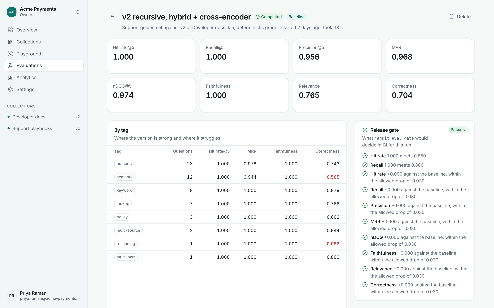

Eight metrics for the whole run, a **By tag** table (where the version is strong and where it
struggles: here the `semantic` and `reasoning` questions have the lowest correctness), and the
**Release gate**: what `ragkit eval gate` would decide in CI, with every check spelled out
("Hit rate 1.000 meets 0.850", "MRR +0.000 against the baseline, within the allowed drop of
0.030"). Below, **Latency per question** and every question: open one to see the expected
sources with the rank they were found at, the retrieved chunks (the relevant one is marked),
the generated and the reference answer and the question's scores.

## 11. Comparing runs

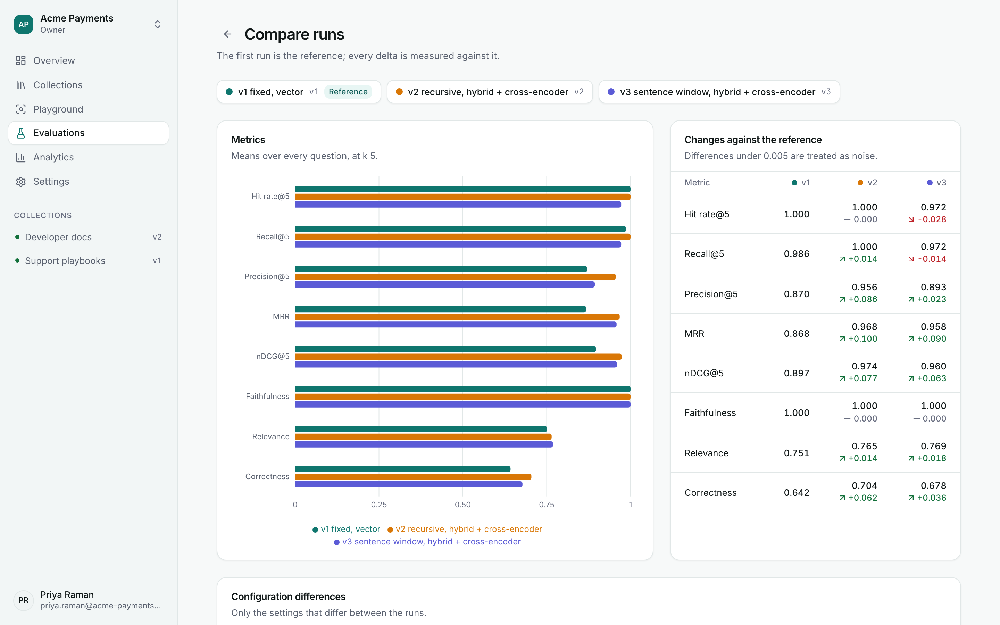

The first run is the reference; every delta is measured against it. v2 beats v1 on precision
(+0.086), MRR (+0.100), nDCG (+0.077) and correctness (+0.062), while v3's sentence windows
trade a little hit rate (-0.028) for better precision than v1. Below the chart, **Configuration
differences** lists only the settings that differ (the chunk size, the strategy, the reranker),
and **Questions** shows which questions improved or regressed between the runs, so you can
open a regression in the playground and see why.

## 12. A dataset and its gate

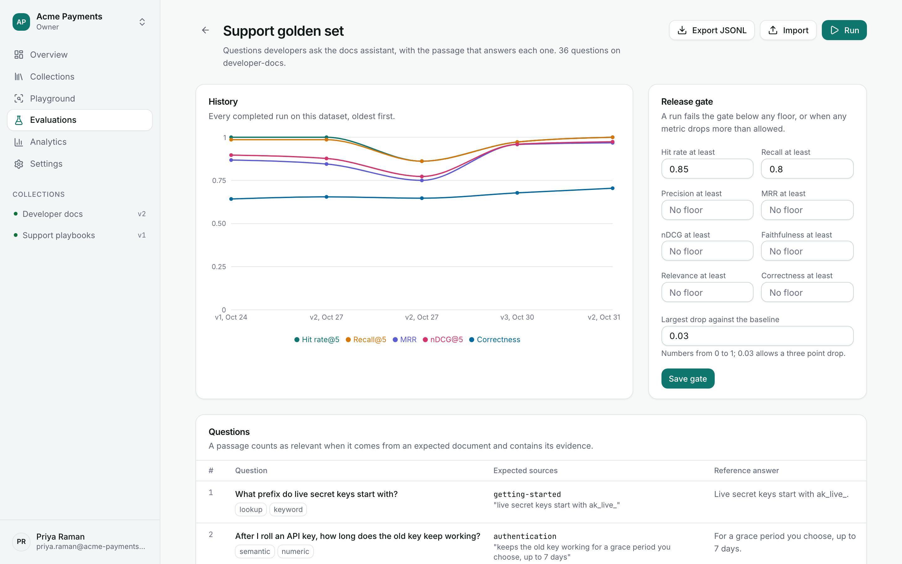

A dataset is a set of real questions. Each one names the document that answers it (by its
`external_id`) and the sentence of evidence, with an optional reference answer and tags.
**Export JSONL** and **Import** move datasets in and out; **Run** starts a run. The **Release
gate** panel stores the thresholds `ragkit eval gate` uses when CI does not pass its own:
floors per metric and the largest drop allowed against the baseline run.

## 13. Analytics

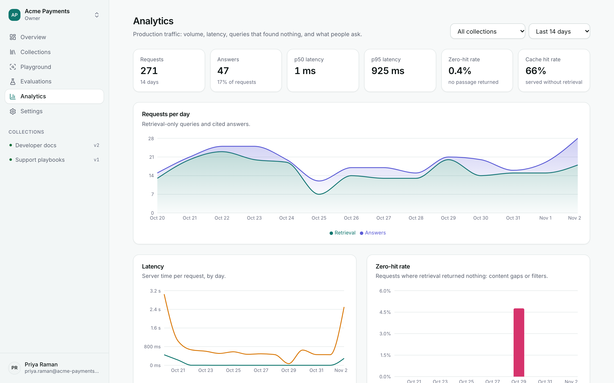

What production looks like: requests per day (retrieval and answers), p50 and p95 latency, the
zero-hit rate per day, the cache hit rate, and the top queries, which open in the playground.
Filter by collection and window. A rising zero-hit rate is a content gap or a filter that is
too tight; the top queries are where to look for questions your dataset is missing.

## 14. API keys

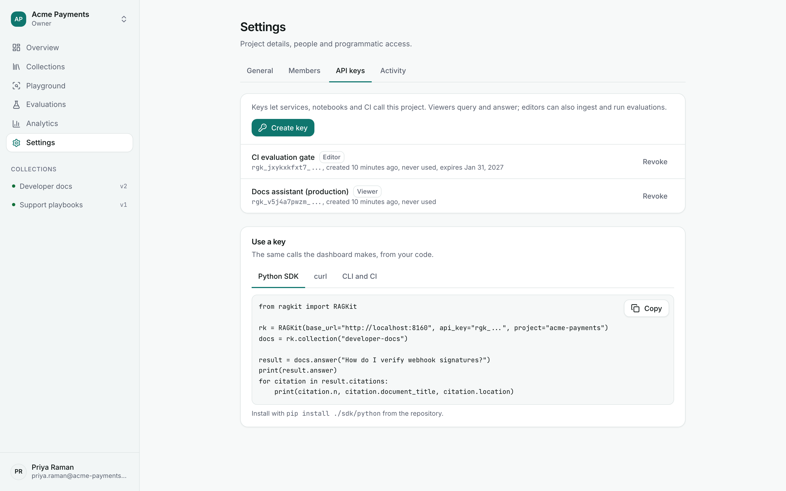

**Settings, API keys**: a viewer key (queries and answers) for the docs assistant, an editor
key (also ingests and runs evaluations) for CI. A new key is shown once. Below, snippets that
run as written for the Python SDK, curl and the CI gate, with your project and API address
filled in. **Members** manages who can do what, and **Activity** lists who changed what.

## 15. The dark theme

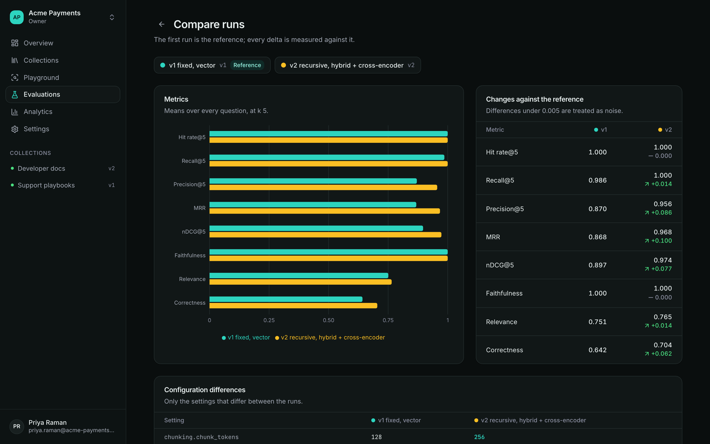

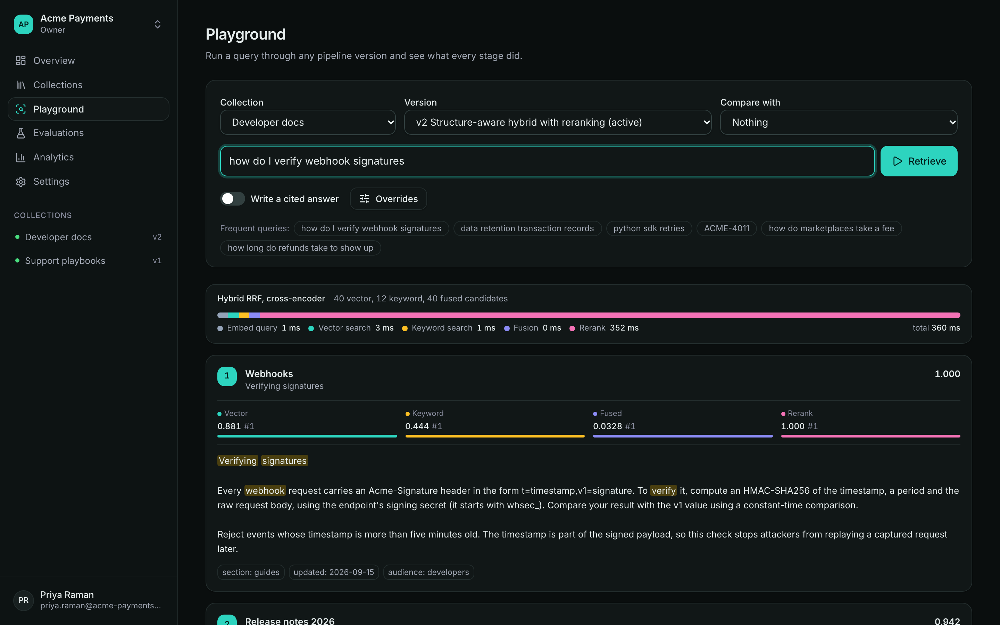

The account menu switches between light and dark (the first visit follows the system
setting). It also holds **Change password**.

## Try it as other people

Sign out (account menu) and sign in as:

- `daniel.okafor@acme-payments.example`, an editor: can add sources, create versions and
  datasets and start runs, but not manage members or API keys. He started most of the demo
  runs.
- `sofia.lindqvist@acme-payments.example`, a viewer: can query, answer and read every run,
  and change nothing (the buttons that would change something are not there, and the API
  agrees).

## An experiment to repeat

1. **Collections, Developer docs, Pipelines, New version**, start from v2, and set **Reranker**
   to **Lexical**. The notice says it reuses the index of v2, so the version is ready at once.
   Name it "Lexical rerank" and create it.
2. **Evaluations, New run**: dataset *Support golden set*, pipeline version 4, label "v4
   lexical rerank". Watch it complete. (For a quick one-off, the same dialog can override the
   mode or the reranker of an existing version without creating a new one; the run records
   what it used.)
3. Tick it and the v2 baseline and press **Compare**. Which metrics moved? Open the questions
   that regressed in the playground, with the same query on both versions.
4. Decide with numbers: if you would ship it, **Make baseline** on its run page; if not,
   leave v2 serving. In CI, `ragkit eval gate support-golden --version 4 --max-drop 0.02`
   makes the same decision automatically.
